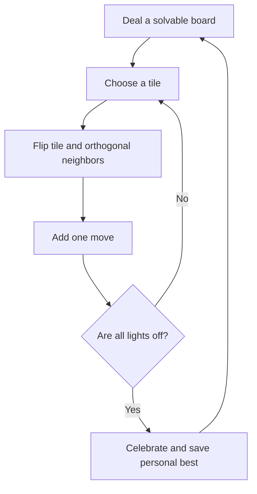

# Grid Ember

A little light logic: a warm, minimal take on the classic Lights Out puzzle. Toggle a tile and its orthogonal neighbors, then find the sequence that brings the board back to quiet.

**Play now:** [oscarmmi.github.io/lights-out](https://oscarmmi.github.io/lights-out/)

## How to play

- Click or tap any tile to flip it and the tiles directly above, below, left, and right.
- Turn every light off to solve the board.
- Use the arrow keys to move the selection, then press **Enter** or **Space** to flip that tile.
- Press **R** or select **New puzzle** to deal a fresh, solvable board.
- Your move count is shown below the grid. Your fewest-move win is saved in this browser.

## Run locally

```sh
npm install
npm run dev
```

Run the game-logic tests and production build with:

```sh
npm test
npm run build
```

## Game loop



## Built with

Vue 3, TypeScript, Vite, and Vitest. The game is entirely client-side; no account or backend is needed.
